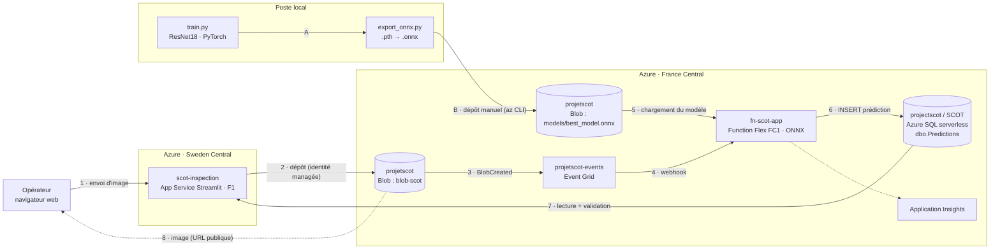

# Architecture SCOT sur Azure

_Système de Contrôle Optique sur surfaces Transparentes — état vérifié avec Azure CLI et sur la base SQL le 13/11/2026, branche `feature/azure-inference`. Ce document ne contient aucun secret : il indique seulement où ils se trouvent._

## 1. Vue d'ensemble

Une image de plaque de verre est déposée dans un stockage Blob, soit par un opérateur depuis l'application web, soit (à terme) par la caméra du montage optique. Le dépôt déclenche automatiquement une Azure Function qui classe l'image avec le modèle ONNX, puis écrit le résultat dans Azure SQL. L'opérateur consulte les résultats dans l'application web et confirme ou corrige chaque prédiction. L'entraînement du modèle reste sur le poste local.



## 2. Le flux, étape par étape

| # | De → vers | Ce qui se passe | Authentification |
|---|---|---|---|
| 1 | Opérateur → `scot-inspection` | L'opérateur ouvre https://scot-inspection.azurewebsites.net, se connecte avec son compte et envoie une ou plusieurs images (png, jpg, jpeg, bmp, tif, tiff). | identifiant + mot de passe propres à l'app (voir §10) |
| 2 | `scot-inspection` → Blob `blob-scot` | L'app dépose chaque image sous le nom `YYYYMMDD_HHMMSS_<nom d'origine>` (heure UTC), sans écraser un fichier existant. | identité managée de l'app, rôle Storage Blob Data Contributor |
| 3 | Blob → Event Grid | Le stockage émet un événement `Microsoft.Storage.BlobCreated` vers le topic système `projetscot-events`. | interne Azure |
| 4 | Event Grid → Function | L'abonnement `blob-scot-to-function` filtre sur `/blobServices/default/containers/blob-scot/` et appelle le webhook `runtime/webhooks/blobs?functionName=Host.Functions.classify_image`. | clé système `blobs_extension` de la Function |
| 5 | Blob `models` → Function | La Function lit les propriétés de `models/best_model.onnx`. Si l'etag a changé (ou au premier appel), elle télécharge le modèle et le garde en mémoire. | chaîne de connexion `AzureWebJobsStorage` |
| 6 | Function → SQL | Les fichiers qui ne sont pas des images sont ignorés. Sinon : prétraitement, inférence ONNX (~10 ms), puis `INSERT` d'une ligne dans `dbo.Predictions`. | identité managée de la Function, jeton Entra ID |
| 7 | SQL → `scot-inspection` | L'app lit les 500 dernières prédictions (cache de 5 s, rafraîchissement auto toutes les 5 à 60 s en mode temps réel) et met à jour les colonnes de validation quand l'opérateur valide. | identité managée de l'app, jeton Entra ID |
| 8 | Blob → navigateur | Le navigateur affiche l'image directement depuis son URL publique (`BlobUrl`). | lecture anonyme du conteneur |
| A | Poste local | `train.py` entraîne le ResNet18 et sauvegarde `outputs/best_model.pth` + une archive `outputs/models_archive/MODEL_<score>_<date>.pth`. | — |
| B | Poste local → Blob `models` | `export_onnx.py` convertit en `.onnx`, vérifie l'égalité des sorties PyTorch/ONNX, puis le fichier est déposé à la main avec `az storage blob upload`. Aucun redéploiement n'est nécessaire. | compte Entra ID de la personne |

## 3. Traitement d'une image dans la Function

Fichiers : `function/function_app.py` et `function/scot_inference.py`. Le prétraitement reproduit exactement celui de `predict.py` et de la validation de `train.py`.

1. Lecture des octets du blob, ouverture avec Pillow.
2. Règle « image noire » : si aucun pixel n'atteint la valeur 1 en niveaux de gris, la classe est `sans_defaut` à 100 % et le modèle n'est pas appelé.
3. Sinon : conversion RGB → niveaux de gris (`L`), redimensionnement bilinéaire en `img_size × img_size` (128 × 128, lu dans les métadonnées du modèle), passage en `[0, 1]`, puis normalisation `(x − 0,5) / 0,5`. Tenseur d'entrée : `image`, forme `[1, 1, 128, 128]`, `float32`.
4. Inférence onnxruntime (CPU), sortie `logits` de forme `[1, 3]`, puis softmax.
5. La classe `sans_defaut` est ajoutée avec une probabilité 0 : le modèle actuel ne connaît que 3 classes.
6. Écriture dans SQL (voir §5).

Métadonnées embarquées dans le fichier `.onnx` par `export_onnx.py` : `classes` (`["inclusion", "rayure", "tache"]`), `img_size` (`128`), `source_checkpoint`, `score` (score CCCC), `metrics` (val_acc, val_loss, train_acc), `timestamp`.

Endpoint de contrôle : `GET https://fn-scot-app-fnascbfubbeududg.francecentral-01.azurewebsites.net/api/health` (anonyme) renvoie le nom du modèle chargé et les classes.

## 4. Ressources Azure

Souscription **Azure for Students** (tenant Université Jean Monnet). Toutes les ressources sont dans le groupe `VisualStudioOnline-E84EAA5FD02E457DBDF1D43E9E02F69B`.

| Ressource | Type | Région | Configuration |
|---|---|---|---|
| `scot-inspection` | App Service (Web App Linux) | Sweden Central | runtime Python 3.12, HTTPS uniquement, WebSockets activés, Always On désactivé, TLS 1.2 min., FTPS seulement, identité managée système |
| `asp-scot-web` | Plan App Service | Sweden Central | Linux **F1** (gratuit) : 60 min de CPU/jour, mise en veille après inactivité |
| `fn-scot-app` | Function App | France Central | Python 3.12, plan **Flex Consumption** (FC1), 2 048 Mo par instance, 100 instances max., HTTPS uniquement, identité managée système |
| `ASP-VisualStudioOnlineE84EAA5FD02E4-ac26` | Plan Function | France Central | FC1 |
| `projetscot` | Compte de stockage | France Central | StorageV2, Standard_LRS, niveau Hot, TLS 1.2 min., HTTPS uniquement |
| `projetscot-events` | Topic système Event Grid | France Central | source : `projetscot` |
| `projectscot` | Serveur logique Azure SQL | France Central | authentification **Entra ID uniquement**, accès réseau public activé |
| `SCOT` | Base Azure SQL | France Central | serverless `GP_S_Gen5_2` (0,5 à 2 vCores), offre gratuite activée, pause auto après 60 min, comportement en fin de quota gratuit : pause |
| `fn-scot-app` | Application Insights | France Central | logs et traces de la Function |
| `appi-scot-inspection` | Application Insights | France Central | logs de l'app web |
| `budget-scot-mensuel` | Budget Cost Management | souscription | 20 par mois, alertes à 80 % (réel) et 100 % (prévu) |
| `DefaultWorkspace-8cead2cd-…-PAR` | Log Analytics | France Central | espace de travail par défaut (groupe `DefaultResourceGroup-PAR`) |

L'app est en Sweden Central parce que le plan F1 n'a pas de quota en France Central sur cette souscription, et que la politique Azure for Students interdit West Europe et North Europe.

## 5. Base de données `SCOT`

### 5.1 Table `dbo.Predictions` — alimentée

C'est la table centrale : **une ligne par image analysée**. Elle est remplie par la Function (`INSERT`) et complétée par l'app web (`UPDATE` des colonnes de validation). Script de création : `sql/schema.sql`.

| Colonne | Type SQL | Null | Écrite par | Contenu |
|---|---|---|---|---|
| `Id` | `INT IDENTITY(1,1)` | non | SQL | clé primaire (index cluster) |
| `BlobName` | `NVARCHAR(400)` | non | Function | nom du fichier dans `blob-scot`, ex. `20261112_152344_P1_1.png` |
| `BlobUrl` | `NVARCHAR(1000)` | oui | Function | URL publique de l'image |
| `PredictedClass` | `NVARCHAR(50)` | non | Function | `tache`, `rayure`, `inclusion` ou `sans_defaut` |
| `Confidence` | `FLOAT` | non | Function | probabilité de la classe prédite, entre 0 et 1 |
| `Probabilities` | `NVARCHAR(MAX)` | oui | Function | JSON de toutes les probabilités, ex. `{"inclusion": 0.004, "rayure": 0.002, "tache": 0.994, "sans_defaut": 0.0}` |
| `ModelName` | `NVARCHAR(200)` | oui | Function | modèle utilisé (`best_model.onnx`) |
| `InferenceMs` | `INT` | oui | Function | durée du prétraitement + inférence, en ms |
| `ImageWidth` | `INT` | oui | Function | largeur de l'image d'origine, en pixels |
| `ImageHeight` | `INT` | oui | Function | hauteur de l'image d'origine, en pixels |
| `CreatedAt` | `DATETIME2` | non | SQL | heure UTC de l'insertion, défaut `SYSUTCDATETIME()` |
| `ValidatedClass` | `NVARCHAR(50)` | oui | App web | classe réelle choisie par l'opérateur (vide tant que non validée) |
| `ValidatedBy` | `NVARCHAR(200)` | oui | App web | nom de l'utilisateur connecté |
| `ValidatedAt` | `DATETIME2` | oui | App web | heure UTC de la validation |
| `OperatorComment` | `NVARCHAR(1000)` | oui | App web | commentaire libre |

Index :

| Nom | Type | Colonnes |
|---|---|---|
| `PK__Predicti__…` | cluster, clé primaire | `Id` |
| `IX_Predictions_CreatedAt` | non cluster | `CreatedAt DESC` |

Requêtes exécutées :

| Par | Requête |
|---|---|
| Function | `INSERT INTO dbo.Predictions (BlobName, BlobUrl, PredictedClass, Confidence, Probabilities, ModelName, InferenceMs, ImageWidth, ImageHeight) VALUES (?, …)` |
| App web | `SELECT TOP (500) … FROM dbo.Predictions ORDER BY CreatedAt DESC, Id DESC` |
| App web | `UPDATE dbo.Predictions SET ValidatedClass = ?, ValidatedBy = ?, ValidatedAt = SYSUTCDATETIME(), OperatorComment = ? WHERE Id = ?` |

Indicateurs calculés par l'app à partir de cette table (onglet Statistiques) : nombre d'images analysées et validées, taux de correction (`ValidatedClass ≠ PredictedClass`), temps d'inférence moyen, répartition des classes prédites, distribution de la confiance, rappel par classe réelle, part de défauts réels prédits `sans_defaut` (à comparer à l'objectif ≤ 10 %) et matrice de confusion réel × prédit.

Contenu au 12/11/2026 : 3 lignes de test (Id 1 à 3), à supprimer.

### 5.2 Table `dbo.DonneesStrioscopie` — non alimentée

Créée avant ce travail, vide, utilisée par aucun code. À supprimer ou à réutiliser pour les paramètres d'acquisition (voir `TODO.txt`).

| Colonne | Type SQL | Null |
|---|---|---|
| `ID` | `INT IDENTITY`, clé primaire | non |
| `NomEchantillon` | `NVARCHAR(255)` | oui |
| `DateAcquisition` | `DATETIME` | oui |
| `Parametre1` à `Parametre5` | `NVARCHAR(100)` | oui |
| `Commentaires` | `NVARCHAR(MAX)` | oui |
| `ImageStrioscopie` | `VARBINARY(MAX)` | oui |

### 5.3 Utilisateurs et droits de la base

| Utilisateur | Type | Droits |
|---|---|---|
| `jonathan.diaz.vreys@…` | administrateur Entra ID du serveur | tous |
| `arthur.col@…`, `enzo.garbi@…`, `hugo.soysouvanh@…`, `tanka.janet.maitre@…` | utilisateurs Entra ID | `db_datareader`, `db_datawriter` (lecture et écriture de toutes les tables) |
| `fn-scot-app` | identité managée de la Function | `SELECT`, `INSERT` sur `dbo.Predictions` |
| `scot-inspection` | identité managée de l'app | `SELECT` sur `dbo.Predictions` ; `UPDATE` limité à `ValidatedClass`, `ValidatedBy`, `ValidatedAt`, `OperatorComment` |

### 5.4 Pare-feu du serveur SQL

| Règle | Adresse | Rôle |
|---|---|---|
| `AllowAllWindowsAzureIps` | 0.0.0.0 | autorise les services Azure (Function, App Service) |
| `Reseau-Universite-Jean-Monnet` | 161.3.0.0 – 161.3.255.255 | tout le réseau de l'université (plage FR-U-STETIENNE, registre RIPE) : accès depuis n'importe quel poste ou navigateur à l'école, y compris l'éditeur de requêtes du portail |
| `PC-<prénom.nom>` | IP publique du moment de chaque membre | accès hors de l'école (maison, 4G) ; créée ou mise à jour par `scripts/sql_firewall_mon_ip.ps1` |

À l'école, rien à faire. Ailleurs, il suffit de relancer le script (après `az login`) :
`powershell -ExecutionPolicy Bypass -File scripts\sql_firewall_mon_ip.ps1`, ou de cliquer sur « Autoriser l'IP » dans l'éditeur de requêtes du portail. Les 4 coéquipiers ont le rôle Contributor sur la souscription, ce qui leur permet de gérer leur propre règle.

Attention : à l'université, le navigateur et les outils en ligne de commande ne sortent pas forcément par la même IP. La règle sur toute la plage couvre les deux. La connexion exige toujours un compte Entra ID autorisé sur la base, car l'authentification SQL par mot de passe est désactivée.

## 6. Stockage `projetscot`

| Conteneur | Accès public | Contenu | Écrit par | Lu par |
|---|---|---|---|---|
| `blob-scot` | lecture anonyme des blobs | images à analyser | app web, opérateurs, (caméra) | Function, navigateurs |
| `models` | privé | `best_model.onnx` (44,8 Mo) | personne de l'équipe (az CLI) | Function |
| `projetscot` | privé | paquets de déploiement de la Function (Flex) | déploiement | plateforme Functions |
| `azure-webjobs-hosts`, `azure-webjobs-secrets` | privé | état interne et clés de la Function | plateforme Functions | plateforme Functions |
| `eventgrid-deadletter` | privé | événements Event Grid non livrés après 24 h (JSON), pour retraiter les images concernées | Event Grid | équipe |

Accès aux données du compte (rôle **Storage Blob Data Contributor**) : Jonathan, Arthur, Enzo, Hugo, Tanka et l'identité de `scot-inspection`.

## 7. Event Grid

| Élément | Valeur |
|---|---|
| Topic système | `projetscot-events`, source : compte `projetscot` |
| Abonnement | `blob-scot-to-function` |
| Type d'événement | `Microsoft.Storage.BlobCreated` uniquement |
| Filtre de sujet | commence par `/blobServices/default/containers/blob-scot/` |
| Destination | webhook de l'extension Blob de `fn-scot-app`, fonction `classify_image` |
| Schéma | EventGridSchema |
| Réessais | 30 tentatives max., durée de vie de l'événement 24 h |
| Dead-letter | conteneur `eventgrid-deadletter` du compte `projetscot` |

## 8. Paramètres d'application

Les valeurs des paramètres secrets ne sont stockées que dans Azure (App Settings) et dans `function/local.settings.json`, qui est exclu de git.

| App | Paramètre | Valeur / rôle |
|---|---|---|
| fn-scot-app | `AzureWebJobsStorage` | **secret** : chaîne de connexion du stockage (déclencheur + lecture du modèle) |
| fn-scot-app | `DEPLOYMENT_STORAGE_CONNECTION_STRING` | **secret** : stockage des paquets de déploiement |
| fn-scot-app | `APPLICATIONINSIGHTS_CONNECTION_STRING` | **secret** : envoi des logs |
| fn-scot-app | `MODEL_CONTAINER` | `models` |
| fn-scot-app | `MODEL_BLOB` | `best_model.onnx` |
| fn-scot-app, scot-inspection | `SQL_SERVER` | `projectscot.database.windows.net` |
| fn-scot-app, scot-inspection | `SQL_DATABASE` | `SCOT` |
| scot-inspection | `STORAGE_ACCOUNT` | `projetscot` |
| scot-inspection | `IMAGE_CONTAINER` | `blob-scot` |
| scot-inspection | `WEBSITES_PORT` | `8000` |
| scot-inspection | `SCM_DO_BUILD_DURING_DEPLOYMENT` | `true` (installe `requirements.txt` au déploiement) |
| scot-inspection | commande de démarrage | `python -m streamlit run app.py --server.port 8000 --server.address 0.0.0.0 --server.headless true --browser.gatherUsageStats false` |
| scot-inspection | `APPLICATIONINSIGHTS_CONNECTION_STRING` | **secret** : envoi des logs vers `appi-scot-inspection` |
| scot-inspection | `SCOT_USERS` | comptes de l'app en JSON : identifiant → nom affiché + empreinte PBKDF2 du mot de passe (jamais le mot de passe). Géré par `scripts/gerer_comptes.py` |
| scot-inspection (option) | `FUNCTION_HEALTH_URL` | URL de `/api/health` ; valeur par défaut codée dans `webapp/app.py` |

## 9. Code et dépendances

| Chemin | Rôle | Exécuté sur | Dépendances principales |
|---|---|---|---|
| `train.py` | entraînement ResNet18 (transfer learning), score CCCC, archivage des modèles | poste local | torch, torchvision, scikit-learn |
| `predict.py` | inférence en ligne de commande (`--image`, `--folder`) | poste local | torch |
| `app.py` | app Streamlit d'origine, sur le dossier local `data_camera/` | poste local | streamlit, torch |
| `export_onnx.py` | export `.pth` → `.onnx` + comparaison PyTorch/ONNX | poste local | torch, onnx, onnxruntime |
| `function/function_app.py` | déclencheur Event Grid `classify_image`, endpoint `/api/health`, écriture SQL | fn-scot-app | azure-functions, azure-identity, azure-storage-blob, pyodbc (ODBC Driver 18) |
| `function/scot_inference.py` | prétraitement + inférence ONNX, sans PyTorch | fn-scot-app | onnxruntime, numpy, Pillow |
| `webapp/app.py` | tableau de bord : inspection, historique, statistiques, envoi, validation | scot-inspection (ou local) | streamlit, pandas, altair, requests |
| `webapp/scot_data.py` | accès SQL (pyodbc + ODBC 18 sur Azure, mssql-python en local) et Blob ; une connexion SQL partagée et réutilisée (reconnexion automatique), réessais au réveil de la base | scot-inspection (ou local) | azure-identity, azure-storage-blob |
| `webapp/run_local.ps1` | lance l'app en local avec le compte `az login` | poste local | — |
| `scripts/sql_firewall_mon_ip.ps1` | ajoute ou met à jour la règle de pare-feu SQL de la personne connectée | poste local | Azure CLI |
| `webapp/scot_auth.py` | empreinte et vérification des mots de passe (PBKDF2-SHA256, 300 000 itérations, sel aléatoire) | scot-inspection | bibliothèque standard |
| `scripts/gerer_comptes.py` | lister, ajouter, réinitialiser, supprimer les comptes de l'app | poste local | Azure CLI |
| `sql/schema.sql` | création de `dbo.Predictions`, index et droits (idempotent) | base SCOT | — |

Environnement local : Python 3.12 dans `.venv` (même version que sur Azure), PyTorch en version CPU.

## 10. Sécurité

- **Aucun mot de passe dans le code.** SQL et Blob sont accessibles par Entra ID : `az login` en local, identités managées sur Azure. Les trois chaînes de connexion de la Function restent dans les App Settings.
- **Moindre privilège** : la Function ne peut qu'insérer et lire, et l'app ne peut modifier que les 4 colonnes de validation.
- **Transport** : HTTPS forcé sur l'app et la Function (HTTP redirigé en 301), TLS 1.2 minimum partout.
- **Supervision** : Application Insights sur la Function (`fn-scot-app`) et sur l'app (`appi-scot-inspection` : envois d'images, validations, erreurs SQL).
- **Coûts** : budget `budget-scot-mensuel` (20 par mois), avec une alerte à 80 % de dépense réelle et une à 100 % de dépense prévue, envoyées à Jonathan et aux Owners. Le crédit restant se consulte sur https://www.microsoftazuresponsorships.com/balance.
- **Connexion à l'app** : page de connexion avec un compte par personne (identifiant `prenom.nom`). Les mots de passe sont stockés uniquement sous forme d'empreinte PBKDF2-SHA256 salée dans le paramètre `SCOT_USERS`. Après 5 échecs, le formulaire est bloqué 60 s, et chaque connexion (réussie ou refusée) est enregistrée dans Application Insights. La validation d'une prédiction est enregistrée au nom de l'utilisateur connecté. En local sans `SCOT_USERS`, l'app s'ouvre sans connexion pour faciliter le développement.
- **Comptes existants** : `jonathan.diaz-vreys`, `arthur.col`, `enzo.garbi`, `hugo.soysouvanh`, `tanka.janet-maitre`, `maxime.maurin`, `admin` (compte partagé « Administrateur SCOT », sans droits supplémentaires dans l'app).
- **Gérer les comptes** (une modification redémarre l'app, ~30 s) :
  `.venv\Scripts\python scripts\gerer_comptes.py lister | ajouter <identifiant> --nom "Prénom Nom" | reinitialiser <identifiant> | supprimer <identifiant>`
- **Points ouverts** :
  - la connexion Entra ID d'App Service (comptes universitaires) n'est pas possible : elle demande une inscription d'application, que les étudiants ne peuvent pas créer dans le tenant de l'université (`allowedToCreateApps = false`) ;
  - le blocage après 5 échecs est lié à la session du navigateur : recharger la page le réinitialise. La protection repose donc surtout sur des mots de passe longs et aléatoires ;
  - la connexion ne protège que l'app : les images de `blob-scot` restent accessibles à qui connaît leur URL exacte ;
  - le conteneur `blob-scot` est lisible publiquement (choix assumé) ;
  - la règle `AllowAllWindowsAzureIps` ouvre SQL à tous les services Azure ;
  - la règle `Reseau-Universite-Jean-Monnet` ouvre SQL à tout le réseau du campus (choix assumé ; l'authentification Entra ID reste obligatoire).

## 11. Mettre à jour

```powershell
# Nouveau modèle (après train.py)
.venv\Scripts\python export_onnx.py --model outputs\best_model.pth
az storage blob upload --account-name projetscot -c models -n best_model.onnx -f outputs\best_model.onnx --auth-mode login --overwrite

# Lancer l'app en local (après az login)
powershell -ExecutionPolicy Bypass -File webapp\run_local.ps1

# Redéployer la Function : zip du contenu de function/ (sans local.settings.json)
az functionapp deployment source config-zip -g <groupe> -n fn-scot-app --src function.zip --build-remote true

# Redéployer l'app : zip de app.py, scot_data.py, requirements.txt
az webapp deploy -g <groupe> -n scot-inspection --src-path webapp.zip --type zip
```

## 12. Limites connues

- Le modèle n'a été entraîné que sur des images de simulation. `sans_defaut` est une règle (image entièrement noire), pas une classe apprise.
- Temps de chargement : trois composants peuvent être en veille. L'app (plan F1, ~20 s pour afficher la page de connexion), la Function (Flex, 5 à 20 s pour recharger le modèle) et la base SQL (pause après 60 min, jusqu'à 1 min). Pour limiter l'attente, l'app réveille la Function et la base en arrière-plan dès l'affichage de la page de connexion, ne bloque jamais l'affichage sur l'état de la Function et réutilise sa connexion SQL (~0,04 s par requête au lieu de 2 s).
- Il n'y a pas encore de chaîne caméra → Blob : les images sont envoyées à la main.
- Pas de CI/CD ni de script d'infrastructure : les ressources ont été créées en ligne de commande.

La liste complète des tâches restantes est dans `TODO.txt`, à la racine du dossier projet.
