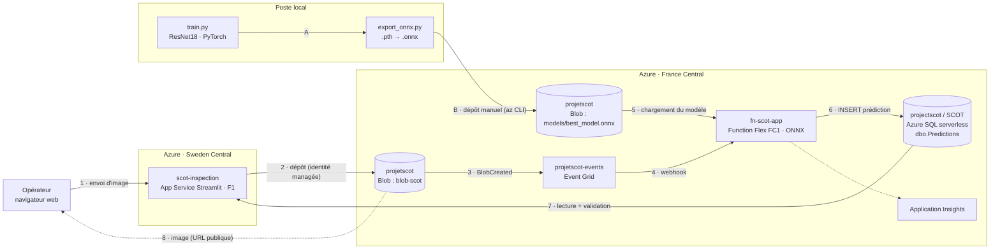

# Architecture SCOT sur Azure

_État au 12/11/2026, branche `feature/azure-inference`. Aucun secret dans ce document._

Une image déposée par un opérateur est classée par le modèle ONNX dans une Azure Function. Le résultat est historisé dans Azure SQL, et l'opérateur le consulte et le corrige dans l'app web. L'entraînement reste en local.



## Le flux

| # | Étape |
|---|---|
| 1 | L'opérateur ouvre https://scot-inspection.azurewebsites.net et envoie une ou plusieurs images. |
| 2 | L'app dépose l'image dans `blob-scot` avec son identité managée (nom horodaté). |
| 3 | Le stockage émet un événement `BlobCreated` vers le topic Event Grid `projetscot-events`. |
| 4 | L'abonnement `blob-scot-to-function` appelle la Function `classify_image`. |
| 5 | La Function charge `models/best_model.onnx`, et le recharge seule si le fichier change (etag). |
| 6 | Classification (~10 ms), puis `INSERT` dans `dbo.Predictions` avec son identité managée. |
| 7 | L'app lit les résultats (auto-scan possible) et enregistre la validation de l'opérateur. |
| 8 | Le navigateur affiche l'image directement depuis son URL publique. |
| A | En local : `train.py` produit un `.pth`, puis `export_onnx.py` le convertit et vérifie que PyTorch et ONNX donnent les mêmes sorties. |
| B | Mise en production d'un modèle : écraser `models/best_model.onnx`. Aucun redéploiement. |

## Ressources Azure

Tout est dans le groupe de ressources `VisualStudioOnline-E84EAA5FD02E457DBDF1D43E9E02F69B` (souscription Azure for Students).

| Ressource | Service | Région · offre |
|---|---|---|
| `scot-inspection` | App Service (Streamlit) | Sweden Central · F1 gratuit |
| `asp-scot-web` | Plan App Service Linux | Sweden Central · F1 |
| `fn-scot-app` | Function App Python 3.12 | France Central · Flex Consumption (FC1), 2 Go |
| `projetscot` | Stockage : `blob-scot` (images), `models` (modèle) | France Central · StorageV2 LRS |
| `projetscot-events` | Event Grid (topic système) | France Central |
| `projectscot` / `SCOT` | Azure SQL | France Central · serverless GP_S_Gen5_2, offre gratuite, pause après 60 min |
| `fn-scot-app` | Application Insights | France Central |

L'app est en Sweden Central parce que le plan F1 n'a pas de quota en France Central, et que la politique Azure for Students interdit l'Europe de l'Ouest et du Nord.

## Accès et droits

Aucun mot de passe dans le code : tout passe par Entra ID (`az login` en local, identités managées sur Azure).

| Qui | Sur quoi | Droits |
|---|---|---|
| Identité `fn-scot-app` | SQL `dbo.Predictions` | SELECT, INSERT |
| Function (paramètre `AzureWebJobsStorage`) | Stockage `projetscot` | déclencheur + lecture du modèle |
| Identité `scot-inspection` | SQL `dbo.Predictions` | SELECT ; UPDATE de `ValidatedClass`, `ValidatedBy`, `ValidatedAt`, `OperatorComment` |
| Identité `scot-inspection` | Stockage `projetscot` | Storage Blob Data Contributor |
| Internet | `blob-scot` | lecture anonyme (choix assumé pour un projet étudiant) |

Les droits SQL sont décrits dans [`sql/schema.sql`](../sql/schema.sql).

## Paramètres d'application

| App | Paramètre | Valeur |
|---|---|---|
| fn-scot-app | `MODEL_CONTAINER` / `MODEL_BLOB` | `models` / `best_model.onnx` |
| fn-scot-app, scot-inspection | `SQL_SERVER` / `SQL_DATABASE` | `projectscot.database.windows.net` / `SCOT` |
| scot-inspection | `STORAGE_ACCOUNT` / `IMAGE_CONTAINER` | `projetscot` / `blob-scot` |
| scot-inspection | commande de démarrage | `python -m streamlit run app.py --server.port 8000 --server.address 0.0.0.0 --server.headless true` |

## Code

| Chemin | Rôle | Où ça tourne |
|---|---|---|
| `train.py`, `predict.py`, `app.py` | entraînement, inférence et app d'origine | local |
| `export_onnx.py` | export `.pth` → `.onnx` + comparaison PyTorch / ONNX | local |
| `function/` | `function_app.py` (déclencheur + endpoint `/api/health`), `scot_inference.py` (prétraitement + ONNX) | fn-scot-app |
| `webapp/` | `app.py` (tableau de bord), `scot_data.py` (SQL + Blob), `run_local.ps1` | scot-inspection, ou en local |
| `sql/schema.sql` | table `dbo.Predictions` et droits | base SCOT |

## Mettre à jour

```powershell
# Nouveau modèle (après train.py)
.venv\Scripts\python export_onnx.py --model outputs\best_model.pth
az storage blob upload --account-name projetscot -c models -n best_model.onnx -f outputs\best_model.onnx --auth-mode login --overwrite

# Lancer l'app en local (après az login)
powershell -ExecutionPolicy Bypass -File webapp\run_local.ps1
```

Pour redéployer la Function ou l'app, zipper le contenu de `function/` (sans `local.settings.json`) ou de `webapp/`, puis :
`az functionapp deployment source config-zip ... --build-remote true` ou `az webapp deploy ... --type zip`.

## Pas encore en place

- Authentification sur l'app : toute personne ayant l'URL peut envoyer et corriger.
- Modèle entraîné uniquement sur des images de simulation. `sans_defaut` est une règle (image entièrement noire), pas une classe apprise.
- Chaîne d'acquisition caméra → Blob.
- Accès des coéquipiers aux données (Blob, SQL) pour travailler en local.
- CI/CD, script d'infrastructure (Bicep), alerte budget.
